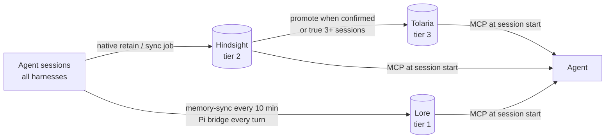

# agent-memory-3-tier

Shared long-term memory for coding agents (OMP, Pi, Claude Code, Codex, Hermes, Gemini/Antigravity), in three tiers:

| Tier | System | Role |
|---|---|---|
| 1 · fast | [Lore](https://github.com/roverdude24/lore) | Raw index of every session from every harness. Hybrid keyword + meaning search. Written only by automation. |
| 2 · middle | [Hindsight](https://github.com/vectorize-io/hindsight) | Durable facts, preferences, and corrections extracted from sessions. One bank per harness. |
| 3 · truth | [Tolaria](https://tolaria.md) | Markdown vault of locked decisions and project status. Written by agents only at milestones. |

Conflicts resolve top-down: user > repo `PROJECT-STATE.md` > Tolaria > Hindsight > Lore.

## Install

Give your agent this instruction:

> Follow INSTALL.md from https://github.com/roverdude24/agent-memory-3-tier. Back up configs first, keep existing MCP servers, and report a verification table at the end.

Or follow [INSTALL.md](INSTALL.md) yourself. About 30 to 45 minutes, plus a background embed of your session history.

## Files

| Path | What it is |
|---|---|
| [MEMORY-RULES.md](MEMORY-RULES.md) | The full contract: tiers, precedence, per-harness wiring, read/write rules |
| [AGENTS-snippet.md](AGENTS-snippet.md) | Short block to paste into `AGENTS.md` / `CLAUDE.md` / `GEMINI.md` |
| [INSTALL.md](INSTALL.md) | Step-by-step install with a check after every phase |
| `scripts/memory-sync.ts` | Bun job: indexes all harnesses into Lore, embeds, retains idle Claude/Codex sessions into Hindsight |
| `scripts/pi-memory-bridge.ts` | Pi extension: live Lore push, Hindsight retain, and memory injection. Also supplies the record builder `memory-sync.ts` uses |
| `scripts/hindsight-mcp.py` | Dependency-free stdio MCP server for Hindsight (`retain`, `recall`, `reflect`, `learn`) |
| `templates/` | launchd plists and the Hindsight launcher script |

## Requirements

macOS (launchd) with Homebrew, Node 26, Bun, Python 3.12, and an OpenAI-compatible LLM endpoint for Hindsight's fact extraction. Everything runs locally on `127.0.0.1`; only Hindsight's extraction calls leave the machine.

## License

MIT. Lore, Hindsight, and Tolaria keep their own licenses.
